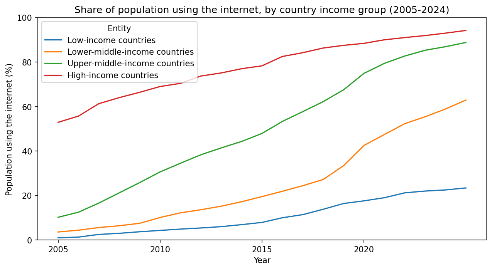
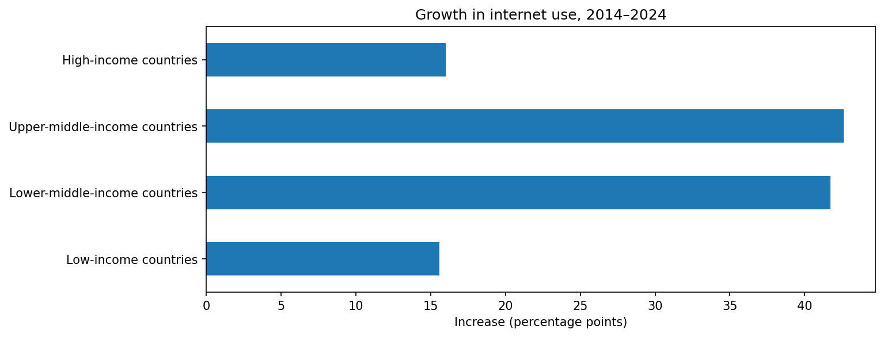

# The Global Digital Divide
### Has internet access grown equally across countries, or are low-income countries being left behind?

## The question
Internet access matters because so much of daily life now depends on it, including school and university. Online learning only works if students can get online. To decide where to invest in internet access, organisations like governments and the United Nations need to know which countries are falling behind. In this project, I want to find out whether internet access has grown equally across countries, or whether some countries, especially lower-income ones, are being left behind.

## The data
- **Internet use:** Share of the population using the internet, from the International Telecommunication Union (ITU) via the World Bank, processed by Our World in Data. An internet user is anyone who used the internet in the last three months. ([source](https://ourworldindata.org/grapher/share-of-individuals-using-the-internet))
- **Income groups:** World Bank income classifications, processed by Our World in Data. The World Bank sorts countries into four groups each year based on average income per person. ([source](https://ourworldindata.org/grapher/world-bank-income-groups))
- **Licence:** Both datasets are CC BY 4.0, which means they're free to use with credit.
- **What one row means:** one country (or group of countries) in one year.
- **Years used:** 2005–2024. Income group averages start in 2005, and I stopped at 2024 because only 10 of 213 countries had reported data for 2025.

## What I did
1. **Explored the data:** checked what one row represents, and renamed the long internet use column so it was easier to work with.
2. **Separated groups from countries:** The data mixed real countries with groups like "World," regions, and income groups. I split them into two tables, so groups weren't counted as countries. I kept Kosovo, because it's a real country that was listed with a non-standard code.
3. **Checked which years had reliable data:** The income group averages start in 2005. I also counted how many countries reported data each year, and stopped at 2024, because only 10 of 213 countries had data for 2025.
4. **Compared income groups over time:** I charted internet use for each income group from 2005 to 2024, and calculated the gap between high- and low-income countries.
5. **Compared growth:** I calculated how much each group grew from 2014 to 2024 in percentage points, not percent, because percent change makes small starting numbers look like huge progress.
6. **Checked who was missing:** I joined a second table of World Bank income groups to the internet data, so I could see which countries in each group had no data.

**Tools:** Python (pandas, matplotlib) in Google Colab

## Key findings

**1. More than 3 in 4 people in low-income countries are still offline.**
In 2024, 93.0% of people in high-income countries used the internet, compared with 22.5% in low-income countries. The gap grew from about 52 percentage points in 2005 to about 73 in 2016, then plateaued at around 70.



**2. Middle-income countries are catching up, but low-income countries are not.**
From 2014 to 2024, internet use grew by about 42 percentage points in both middle-income groups. Low-income countries grew by only 15.6 points, about the same as high-income countries (16.0), even though they had far more room to grow. This is why the gap stopped growing but did not shrink.



**3. The least connected countries may be missing from the data.**
Six low-income countries had no internet data for 2024: Syria, Sudan, South Sudan, Yemen, North Korea and Eritrea. These are countries affected by conflict or with tightly controlled communication, home to well over 100 million people. The low-income average may therefore make the divide look smaller than it really is.

**What this could mean:** Organisations investing in internet access may get the most impact by focusing on low-income countries specifically, since middle-income countries are already catching up on their own.

## Limitations
- The data shows national averages, so it can't show differences **within** a country, such as between richer and poorer people, or cities and rural areas.
- An "internet user" is anyone who went online in the last three months, so someone with occasional access counts the same as someone online every day.
- Recent years rely partly on estimates, because countries report their data late.
- The high-income vs low-income gap may be affected by a ceiling effect: high-income countries are close to 100%, so they have little room left to grow.
- Countries can change income groups over time. I used the World Bank's 2024 groups for the missing-data check.

## Data ethics note
- **Missing data isn't random:** The countries without data are often the ones in conflict or with closed governments. Their people are likely among the least connected, but they're invisible in the averages. Decisions based only on this data could overlook them.
- **Averages hide people:** A country average can look reasonable while large groups inside that country remain offline.
- **Measuring progress fairly:** I used percentage-point change instead of percent change, because percent change can make small gains look like huge progress and hide how far behind low-income countries still are.

## What I'd do next
- **Add population data** to measure the divide in people, not just countries, and to check how many people live in the countries with missing data.
- **Look within countries,** such as urban vs rural or men vs women, where data is available.
- **Update the analysis** once more countries report 2025 data.
- **Explore why** some countries grow faster, for example by comparing internet use with the cost of mobile data.

## How to run this project
1. Open `digital_divide_analysis.ipynb` in Google Colab.
2. Click **Runtime → Run all**. The notebook downloads both datasets directly from Our World in Data, so no extra files are needed.
3. To run it on your own computer instead, install the packages in `requirements.txt` first.

## Folder structure
```
digital-divide-analysis/
├── README.md                      ← this file
├── digital_divide_analysis.ipynb  ← all the code, notes and charts
├── requirements.txt               ← Python packages needed
└── *.png                          ← charts used in this README
```
